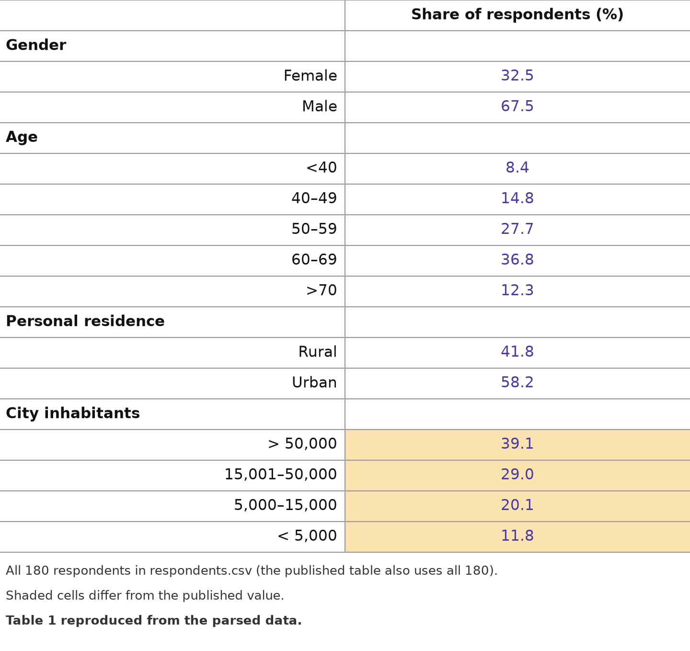
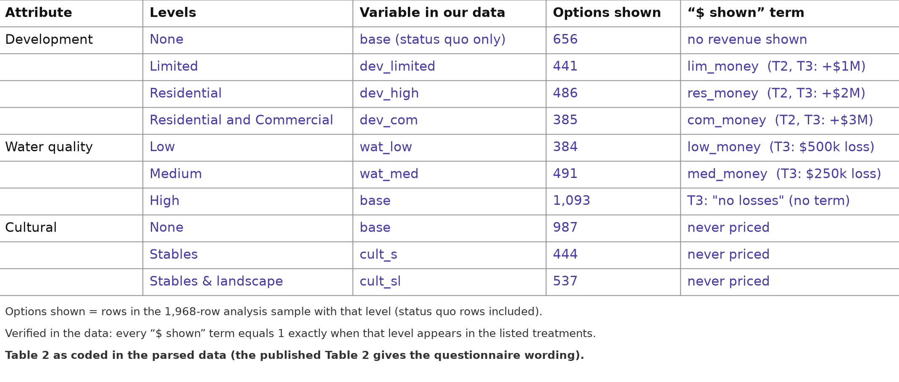
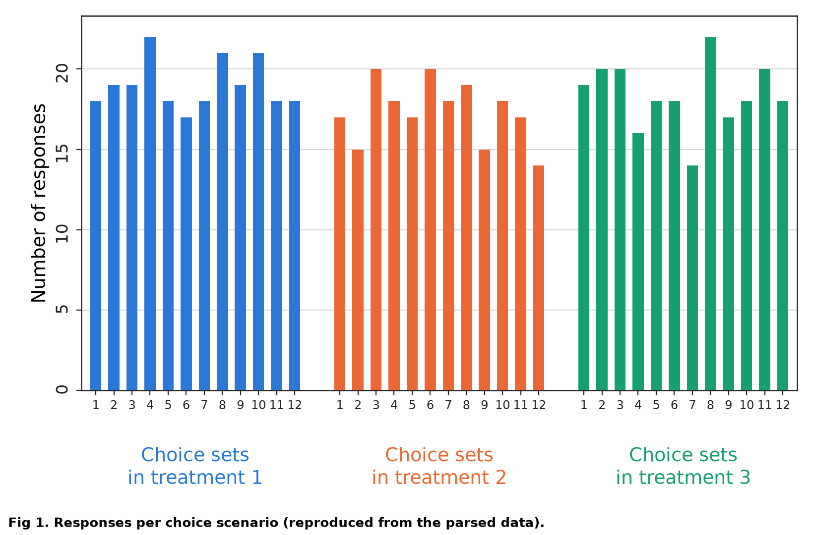
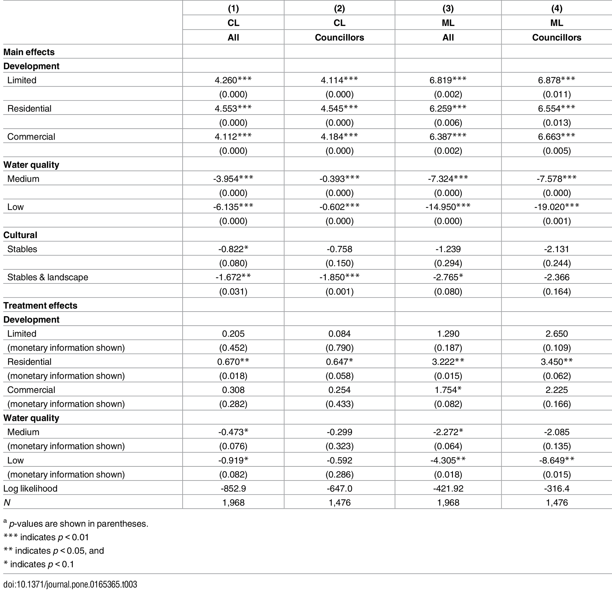
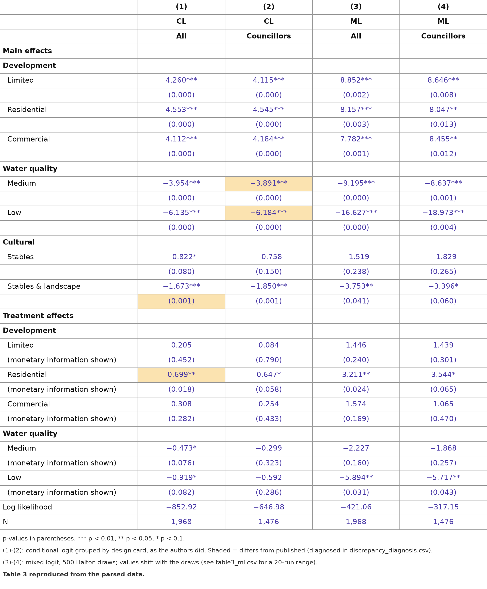
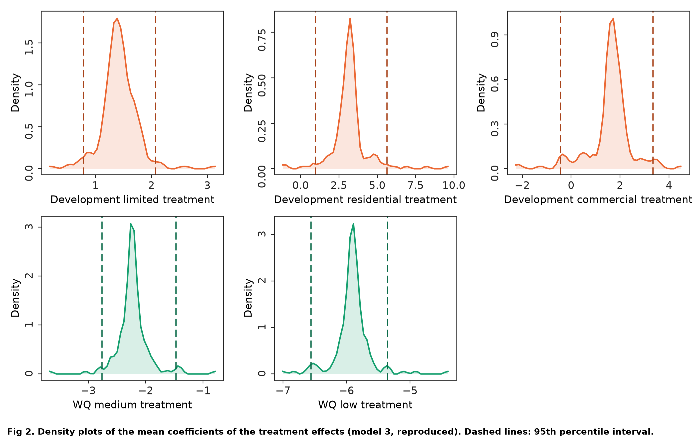
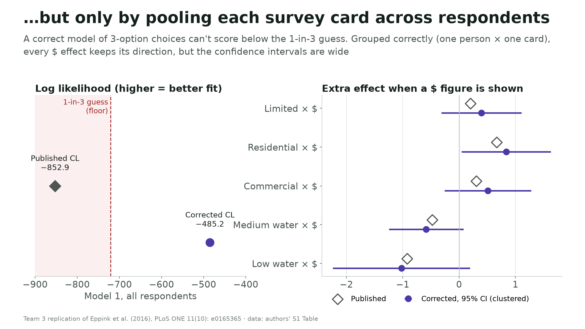
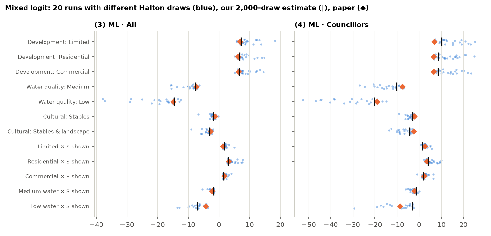

Non-Market Values in a Cost-Benefit World

A Replication of Eppink et al. (2016)

Daniel T. · Alistair K. · Matthew S. · Sam W.

ECON S5560 · Team 3 · Draft template · 10 October 2026

Working draft: replace bracketed prompts with team-written prose. Pages 1-5 reserve the narrative; references and exhibits are additional.

## Abstract

[Write 100-150 words: question, replication targets, what matched, what remains uncertain, and the stakeholder takeaway.]

# 1  Introduction: the problem and the paper

Source anchor. Eppink et al. (2016) study whether adding monetary information changes choices among development projects with water-quality and cultural-heritage impacts. T1 shows qualitative information; T2 adds development revenue; T3 also adds water-quality losses. Heritage remains unpriced.

[Write about half a page: explain the policy problem, state the authors' headline finding, and define the scope of this replication. Distinguish the paper's conclusion from our evidence.]

# 2  Reproducibility: what we did

## 2.1  Data access and sample construction

Data anchor. Public S1Table.DTA: 2,160 alternative rows and 180 respondents. The repository's complete-response sample contains 164 respondents, 656 choice occasions and 1,968 rows; the councillor sample contains 123 respondents and 1,476 rows. Complete-response treatment counts are 57 / 52 / 55.

[Describe access, exclusions, duplicate-card handling and the two role-text classifications. Explain why Table 1 and the estimation tables use different denominators. See Tables A1-A2.]

## 2.2  Methods and implementation

[Describe conditional logit and panel mixed logit, the reference levels and the five monetary-information interactions. Separate design-card pooling used to reproduce the published CL table from respondent-by-card grouping with respondent-clustered uncertainty. See Table A3 and Figure A3; Train, 2009; Hole, 2007.]

## 2.3  What we reproduced and what we could not

[Report Table 1, all 36 Figure 1 bars, CL coefficients and p-values, and ML simulation sensitivity. State tolerances and failures. The exhibit redraw uses 500 Halton draws; the main ML output uses 2,000 draws and a 20-seed sensitivity exercise. These are different runs.]

# 3  Appraisal: methods and academic audience

## 3.1  Identification and experimental design

[Assess information-treatment assignment, survey selection, nonresponse, the hypothetical decision context and the small number of respondents per arm. Explain what T3 can identify when development and water prices are shown together. Distinguish decision weights from willingness to pay.]

## 3.2  Choice-set definition and statistical inference

[Use Table A3 and Figure A3 to discuss grouping, repeated decisions, clustering and the IIA assumption. Explain why coefficient magnitudes from different specifications require care. Anchor the discussion in Train (2009) and Cameron and Miller (2015).]

## 3.3  Mixed-logit robustness

[Use Figure A2 and Figure A3 to discuss random-coefficient assumptions, simulation draws, convergence and the councillor-only model. Explain the difference between a sensitivity range and a confidence interval; do not treat approximate fits as exact replications. See Hole (2007).]

# 3  Appraisal (continued): literature and unresolved discrepancies

## 3.4  Relation to the literature

[Write the comparison with at least five scholarly sources beyond Eppink et al. Use the references below as a starting set, cite specific claims in the prose, and add relevant empirical comparisons if needed. Compare stated-preference practice (Johnston et al., 2017) and plural environmental values (Kallis et al., 2013) with this design.]

## 3.5  Reporting discrepancies and limits of our diagnosis

[Discuss mismatched town-size shares, CL water cells, the residential interaction, the heritage p-value, and the Figure 2 model label. Separate observed numerical discrepancies from explanations. A compatible n = 188 calculation does not establish which dataset the authors used; matching a standard error is evidence of a possible reporting issue, not author confirmation.]

## 3.6  Remaining checks

[Prioritize unresolved checks: author code/data clarification, Stata mixlogit confirmation if available, IIA diagnostics and alternative treatment contrasts. State which were not performed. Do not claim the implementation is error-free solely because selected numbers agree.]

# 4  Recommendations: real-world audience

## Intended reader

[Name the organization or stakeholder. Working audience: a planning or water-quality organization reviewing development impacts. Replace this with the team's chosen audience.]

## 4.1  Main takeaway

[Lead with one plain-language message. Explain what the evidence suggests about displaying money alongside unpriced environmental and cultural impacts, and how confident we should be.]

## 4.2  Recommended action

[Give two or three practical actions. Link each action to an exhibit and the appraisal. Explain how to present unpriced impacts clearly without assuming every impact can or should receive a price.]

## 4.3  Cautions and conclusion

[Explain limits on transferring a hypothetical 2015 New Zealand survey to this stakeholder. State what this study cannot tell us about local dollar values or actual project approval. End with a concrete decision-relevant conclusion.]

# References

APA author-date starting set. The five supporting scholarly sources below were checked against publisher or author/institutional records; the team must read and connect each source to the specific claims it ultimately writes.

Eppink, F. V., Winden, M., Wright, W. C. C., & Greenhalgh, S. (2016). Non-market values in a cost-benefit world: Evidence from a choice experiment. PLOS ONE, 11(10), e0165365. https://doi.org/10.1371/journal.pone.0165365

Cameron, A. C., & Miller, D. L. (2015). A practitioner's guide to cluster-robust inference. Journal of Human Resources, 50(2), 317-372. https://doi.org/10.3368/jhr.50.2.317

Hole, A. R. (2007). Fitting mixed logit models by using maximum simulated likelihood. The Stata Journal, 7(3), 388-401. https://doi.org/10.1177/1536867X0700700306

Johnston, R. J., Boyle, K. J., Adamowicz, W. (V.), Bennett, J., Brouwer, R., Cameron, T. A., Hanemann, W. M., Hanley, N., Ryan, M., Scarpa, R., Tourangeau, R., & Vossler, C. A. (2017). Contemporary guidance for stated preference studies. Journal of the Association of Environmental and Resource Economists, 4(2), 319-405. https://doi.org/10.1086/691697

Kallis, G., Gómez-Baggethun, E., & Zografos, C. (2013). To value or not to value? That is not the question. Ecological Economics, 94, 97-105. https://doi.org/10.1016/j.ecolecon.2013.07.002

Train, K. E. (2009). Discrete choice methods with simulation (2nd ed.). Cambridge University Press. https://eml.berkeley.edu/books/choice2.html

Template structure reference (not one of the five additional topical sources): Korpershoek, J., Musumeci, M., Stans, R. A., & Totarelli, M. (2023). Teacher influence in music composition since 1450: A replication of Borowiecki (2022). I4R Discussion Paper No. 27. https://hdl.handle.net/10419/270744

# Attribution, AI use and submission notes

## Team attribution

Charter responsibilities are listed as a starting point, not a claim of completed work. Replace each bracket with actual contributions before submission.

Daniel T. | Writing/presentation; organization | [Actual work completed]

Alistair K. | Data analysis | [Actual work completed]

Matthew S. | Data analysis | [Actual work completed]

Sam W. | Point of contact; writing/presentation | [Actual work completed]

## AI-use disclosure (draft; team to review)

The repository records use of Claude (Anthropic) to draft code, the dashboard and documentation; OpenAI Codex organized this memo template, inserted repository exhibits and prepared the submission package. [Add the team's own review and verification process, and confirm this disclosure accurately reflects all AI use.]

## Before submitting

Replace all bracketed prompts; complete the five-page narrative (single-spaced, 11-12 pt, 1-inch margins); cite at least five additional scholarly sources in the text; verify attribution and disclosure; refresh the PDF and DOCX exports after edits.

The saved Canvas assignment says only the draft memo is required now. Data and replication files are being packaged for the final submission. This template is a writing scaffold, not a completed five-page memo.

## Exhibit provenance

Figures below are the team's committed outputs at repository revision 0ef7bc1. Reproduced article material is credited to Eppink et al. (2016), CC BY 4.0. Numerical tables and code are included in the submission package.

# Table A1. Respondent characteristics

Team redraw of published Table 1 from respondents.csv. Shading marks mismatches. Gender, age and residence match the displayed published shares; city-size shares do not. Published city shares: 36.7 / 30.9 / 21.3 / 11.2%. Each item uses its available-response denominator. Source: Eppink et al. (2016), Table 1; 02_descriptives.py and 07_paper_figures.py.

[Write the comparison, explain denominators, and state what remains unresolved.]

# Table A2. Attributes, levels and treatment coding

Team coding counterpart to published Table 2, rather than a verbatim reproduction of questionnaire wording. Counts refer to alternative rows in the 1,968-row complete-response sample, including status quo. Source: Eppink et al. (2016), Table 2; choice_long.csv; 07_paper_figures.py.

[Describe base levels, development pricing in T2/T3, water pricing in T3, and why heritage is unpriced. Do not interpret options shown as choices selected.]

# Figure A1. Responses per choice scenario

Team reproduction of published Figure 1. Bars count answered scenarios by design card and treatment, not selected alternatives. T1/T2/T3 totals are 228 / 208 / 220 choices from 57 / 52 / 55 complete respondents. Source: Eppink et al. (2016), Figure 1; 03_fig1_responses_per_choice_scenario_comparison.csv.

[Describe whether the 36 bar heights match, and explain what this validates about the reconstructed sample.]

# Table A3, Panel A. Published regression results

Original Table 3, reproduced from Eppink et al. (2016), PLOS ONE, doi:10.1371/journal.pone.0165365.t003, CC BY 4.0. Parentheses contain p-values. The following page gives the team's counterpart.

[Identify the main comparisons and flag cells for discussion; preserve the published values when describing discrepancies.]

# Table A3, Panel B. Team replication results

Team redraw: CL uses design-card pooling; ML uses 500 scrambled Halton draws, seed 2016. Parentheses contain p-values. This is the exhibit run, not the 2,000-draw primary ML estimate. Source: 07_paper_figures.py and 04_table3_regression_results_comparison.csv.

[Compare Panels A and B. Use table3_cl.csv for respondent-by-card estimates and table3_ml.csv for primary ML and sensitivity results.]

# Figure A2. Individual monetary-information effects

Team reconstruction of published Figure 2: model 3, all complete respondents, 500 scrambled Halton draws, seed 2016. The published text names model 4; the repository treats the panel locations as evidence for model 3. This attribution remains an inference. Dashed lines are the 2.5th and 97.5th percentiles of respondent-specific posterior mean coefficients; they are not a confidence interval for a single treatment effect. Source: 07_paper_figures.py; 05_fig2_treatment_effect_densities_summary.csv.

[Discuss similarities, the low-water panel, uncertainty-band construction and the unresolved model-label discrepancy. The councillor-only variant is also supplied in the package.]

# Figure A3. Specification and simulation sensitivity

Panel A. Team comparison of design-card pooling and respondent-by-card grouping. Use the CSV results to discuss uncertainty as well as magnitudes. Source: 03_conditional_logit.py and 06_slide_figures.py.

Panel B. Team mixed-logit sensitivity exercise: 20 draw sequences with 500 draws each, alongside the published estimates. The range is simulation sensitivity, not a confidence interval. Source: 04_mixed_logit.py.

[Write the robustness conclusion and its implications for the stakeholder.]